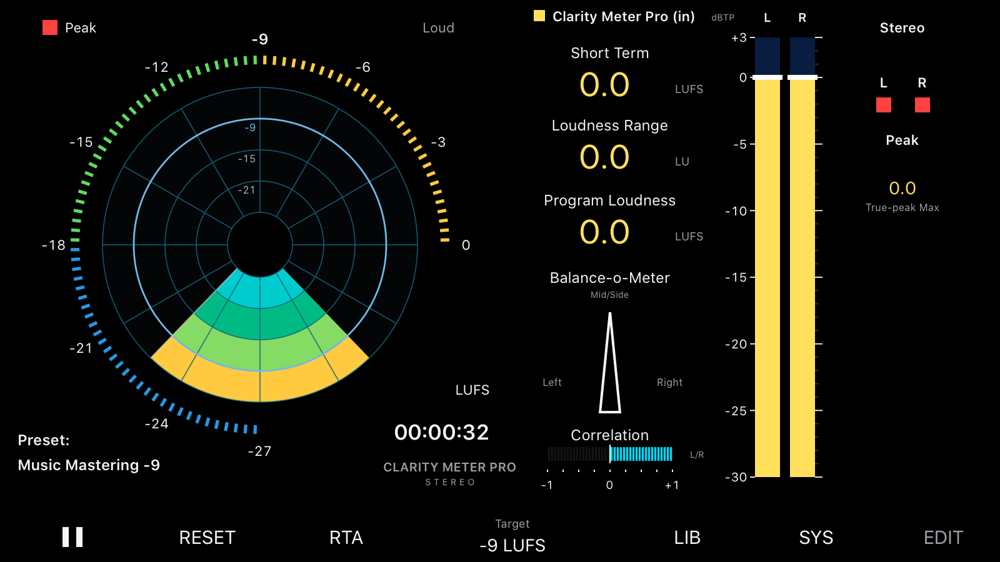

# 🎚️ Clarity Meter Pro

**Medidor de loudness profissional para Mac. Grátis.**

App de segunda tela + plug-in **VST3**, **AU** (Logic) e **AAX** (Pro Tools) com Loudness Radar, LUFS, True Peak, RTA e correlação de fase.

> Desenvolvido por **Palitomix** · Instagram [@PalitoMix_](https://instagram.com/PalitoMix_)

---

## ⬇️ Download

👉 **[Baixar o Clarity Meter Pro 1.0.0 (macOS)](https://github.com/maycondjpalito-collab/ClarityMeterPro/raw/main/downloads/ClarityMeterPro-1.0.0-macOS.zip)**

O pacote traz o app, os plug-ins VST3, AU e AAX e um instalador.

**Requisitos:** macOS 10.15 (Catalina) ou mais novo · Apple Silicon (M1, M2, M3, M4…) ou Intel.

---

## ✨ O que ele mede

| | |
|---|---|
| 📡 **Loudness Radar** | Histórico do Short Term girando + anel de LEDs com o Momentary, resolução de 3, 6, 9 ou 12 dB |
| 🔊 **LUFS** | Integrado (Program Loudness), Short Term, Momentary, Loudness Range (LRA) e máximos — padrão **EBU R128 / ITU-R BS.1770** |
| ⚠️ **True Peak** | Barras L/R até +3 dBTP com marcador de pico branco (segura 3 s quando passa de 0 dBTP) |
| 📊 **RTA** | 31 bandas de 1/3 de oitava |
| 🎧 **Estéreo** | Vectorscope, correlação, Balance-o-Meter e Mono Deviation |
| 🎯 **Alvos** | +20 prontos (Spotify, Apple Music, YouTube, Amazon, Tidal, Deezer, EBU R128, ATSC A/85, podcast, Music Mastering) ou valor personalizado |
| 🎨 **Temas** | Vários temas de cores |

O áudio passa pelo plug-in **sem nenhuma alteração**: ele só mede.

---

## 🛠️ Como instalar

1. Descompacte o `.zip` baixado.
2. Clique com o **botão direito** em **`Instalar Clarity Meter Pro.command`** → **Abrir**.
3. Aperte **Enter** e digite a **senha do Mac** quando pedir (ela não aparece enquanto você digita, é normal).

| Item | Pasta |
|---|---|
| App | `Aplicativos` |
| VST3 | `~/Library/Audio/Plug-Ins/VST3` |
| AU | `~/Library/Audio/Plug-Ins/Components` |
| AAX | `/Library/Application Support/Avid/Audio/Plug-Ins` |

### 🔒 O macOS bloqueou o instalador?
Abra **Ajustes do Sistema → Privacidade e Segurança**, role até o aviso do `Instalar Clarity Meter Pro.command` e clique em **Abrir Mesmo Assim**.

---

## 🎛️ Como usar

### Na DAW (plug-in)
Coloque o **Clarity Meter Pro** no **último insert do Master**.

- **Pro Tools (AAX):** categoria **Sound Field**, fabricante Palitomix. Insira como *multichannel → stereo*.
- **Logic Pro (AU):** Audio Units → Palitomix → Clarity Meter Pro.
- **Cubase, Studio One, Reaper, Ableton, FL Studio… (VST3):** procure por Palitomix / Clarity Meter Pro.

### App de segunda tela
Mede tudo o que sai do Mac (DAW, player, navegador) usando o **BlackHole 2ch**, que é grátis e instalado à parte:

1. Instale o **[BlackHole 2ch](https://existential.audio/blackhole/)** e reinicie o Mac.
2. Abra o **Clarity Meter Pro** em Aplicativos → **Opções (⌘,)** → entrada = **BlackHole 2ch**, saída = sua interface de áudio.
3. Com o roteamento automático ligado, o som continua saindo nos seus monitores e o medidor mostra tudo.

**Atalhos:** `R` zera · `M` troca Radar / RTA / Scope · `T` troca o tema · `Espaço` inicia/para · roda do mouse = alvo (±1 LU; com Option ±0,5).

---

## 📄 Licença

**Freeware**: grátis para uso pessoal e profissional (pode usar em trabalhos pagos). Veja [`LICENCA.txt`](LICENCA.txt).
Avisos de componentes de terceiros: [`AVISOS-DE-TERCEIROS.txt`](AVISOS-DE-TERCEIROS.txt).

Este projeto é independente e **não tem afiliação** com a TC Electronic, a Music Tribe, a Avid ou a Steinberg. As marcas citadas pertencem aos seus donos.

---

Feito em Campo Grande – MS por **Palitomix**. Se o medidor te ajudou, marca o [@PalitoMix_](https://instagram.com/PalitoMix_) e compartilha! ⭐
